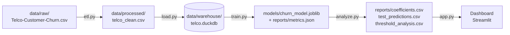

# Predicción de churn — Telco

Una empresa de telecomunicaciones quiere identificar qué clientes tienen más riesgo de darse de baja (churn) para poder contactarlos a tiempo.

## Resultado

Sobre el conjunto de test (clientes que el modelo no vio al entrenar):

- **Recall en la clase churn: 78.34%** — de cada 10 clientes que efectivamente se dan de baja, el modelo detecta a casi 8.
- **ROC-AUC: 0.8416**
- **Precision en la clase churn: 50.43%** (a este recall, la mitad de los clientes marcados como riesgo no se termina yendo)
- **9 tests pasando** (`pytest`)

Fuente: `reports/metrics.json`, generado por `src/train.py`.

## Hallazgos

Estos puntos salen de los coeficientes de la regresión logística (`reports/coefficients.csv`) y de los datos reales agregados por tipo de contrato. Son **asociaciones estadísticas, no relaciones de causalidad**.

- El contrato mes a mes es la asociación individual más fuerte con el churn entre las variables categóricas (coeficiente +0.66), y se confirma en los datos reales: **42.7% de churn en contratos mes a mes, contra 11.3% en contratos de un año y 2.8% en contratos de dos años** (coeficiente del contrato de dos años: -0.78).
- Tener internet por fibra óptica es la variable individual con mayor asociación positiva (+0.71). Es un indicio, no una explicación: podría reflejar que estos clientes pagan más o tienen más alternativas en el mercado, no que la fibra en sí misma cause la baja.
- La antigüedad (`tenure`) es la variable con mayor asociación negativa (-1.15): cuantos más meses lleva un cliente, menos probable es que se dé de baja.
- No tener ningún servicio de internet contratado reduce fuertemente el riesgo asociado (suma de -1.95 entre las 7 columnas relacionadas a "sin internet"). Es probable que sean clientes con un plan más simple y menos puntos de fricción, no que "no tener internet" proteja contra el churn por sí solo.

## Dataset

[Telco Customer Churn (IBM)](https://www.kaggle.com/datasets/blastchar/telco-customer-churn), un dataset de ejemplo de una empresa de telecomunicaciones ficticia: 7.043 clientes, 21 columnas (demografía, servicios contratados, facturación y si se dieron de baja).

El CSV crudo **no se versiona** en este repo (está en `.gitignore`). Para correr el pipeline, descargalo y colocalo en:

```
data/raw/Telco-Customer-Churn.csv
```

## Arquitectura



- **`src/etl.py`** — limpia el CSV crudo: convierte `TotalCharges` a numérico, rellena los vacíos con 0, mapea `Churn` a 0/1, y guarda `data/processed/telco_clean.csv`.
- **`src/load.py`** — carga el CSV limpio a una tabla `customers` en DuckDB (`data/warehouse/telco.duckdb`), de forma idempotente (`CREATE OR REPLACE`).
- **`src/train.py`** — entrena una regresión logística sobre la tabla `customers`, evalúa sobre un test set estratificado, y guarda el modelo y las métricas.
- **`src/analyze.py`** — carga el modelo entrenado, reproduce el mismo split de test, y genera los reportes de coeficientes, predicciones y análisis de umbrales.
- **`src/app.py`** — dashboard de Streamlit que lee los reportes generados por `analyze.py` (no toca el modelo ni la base directamente).

## Decisiones técnicas

- **`TotalCharges` vacío se rellena con 0, no con la media.** Los 11 valores vacíos del dataset corresponden a clientes con `tenure == 0` (recién dados de alta, todavía no facturados); `etl.py` valida esto con un `assert` antes de rellenar.
- **Se optimiza y reporta recall en la clase churn, no accuracy.** El dataset está desbalanceado (~26.5% churn), así que una accuracy alta se puede lograr prediciendo "no churn" siempre. El modelo usa `class_weight="balanced"` para priorizar no perderse clientes en riesgo.
- **Las métricas se miden sobre clientes que el modelo no vio entrenar.** El split es 80/20 estratificado por `Churn`, con `random_state=42` fijo, reutilizado igual en `train.py` y `analyze.py`.
- **El umbral de decisión es una decisión de negocio, no una elección técnica fija.** Bajarlo captura más churners reales a costa de contactar más falsos positivos, y subirlo hace lo contrario. El dashboard deja explorar ese trade-off entre 0.1 y 0.9 en vez de fijar un único umbral en el código.

## Cómo correrlo

Crear y activar un entorno virtual, e instalar dependencias:

```
python -m venv .venv
source .venv/Scripts/activate        # Windows PowerShell: .venv\Scripts\Activate.ps1
pip install -r requirements.txt
```

Correr el pipeline en orden (requiere haber colocado el CSV crudo, ver sección Dataset):

```
python src/etl.py
python src/load.py
python src/train.py
python src/analyze.py
```

Para los tests hace falta además `requirements-dev.txt` (ahí vive `pytest`):

```
pip install -r requirements-dev.txt
python -m pytest
```

Para levantar el dashboard (necesita los reportes de `analyze.py` ya generados):

```
streamlit run src/app.py
```

## Estructura de carpetas

```
.
├── CLAUDE.md                  # instrucciones para el asistente de IA (Claude Code)
├── data/
│   ├── raw/                   # CSV crudo (no versionado)
│   ├── processed/             # CSV limpio generado por etl.py (no versionado)
│   └── warehouse/             # base DuckDB generada por load.py (no versionada)
├── models/                    # modelo entrenado por train.py (no versionado)
├── notebooks/
│   └── eda.ipynb              # exploración inicial de los datos
├── reports/                   # métricas y reportes generados por train.py / analyze.py
├── requirements.txt
├── requirements-dev.txt
├── pytest.ini
├── src/
│   ├── etl.py
│   ├── load.py
│   ├── train.py
│   ├── analyze.py
│   └── app.py
└── tests/
    ├── test_etl.py
    └── test_data_quality.py
```

## Qué haría en producción

Este proyecto corre a mano, en orden, sobre un dataset estático — está bien para este alcance, pero no para producción. Si este pipeline tuviera que correr de forma continua:

- **Orquestación con Airflow** (u otro scheduler) para encadenar `etl.py → load.py → train.py → analyze.py` con reintentos y alertas, en vez de ejecutarlos a mano.
- **Cargas incrementales** en vez de reprocesar todo el dataset en cada corrida.
- **Monitoreo del modelo**: trackear drift en las features y degradación de recall/precision en producción, no solo en el test set fijo de hoy.
- **Dockerizar** el pipeline y el dashboard para que el entorno sea reproducible fuera de esta máquina.

No se implementó nada de esto porque el dataset es estático (un CSV fijo, sin nuevos clientes llegando) y no hay un sistema productivo real detrás todavía.

## Limitaciones

- Es un dataset de ejemplo (IBM/Kaggle), no datos reales de una telco — los resultados no necesariamente generalizan a otro negocio.
- Los coeficientes del modelo son asociaciones estadísticas, no relaciones de causalidad (ver sección Hallazgos).
- Solo se probó regresión logística. Valdría la pena comparar contra un modelo no lineal como Random Forest o Gradient Boosting antes de elegir uno para producción.
